# MyShop Database Design

This is the proposed PostgreSQL logical and physical design. It is a specification for future migrations, not an installed schema. Domain ownership and workflows are defined in [Backend system design](BACKEND-SYSTEM-DESIGN.md).

## Data conventions

- Primary keys use server-generated UUIDs. Human order/document numbers are separate unique values allocated by the server.
- Mutable rows have `created_at`, `updated_at` and an integer `version` where optimistic concurrency is needed. Events and ledgers are append-only.
- Timestamps use `timestamptz`, stored in UTC. Business date filters use Asia/Dhaka boundaries converted to UTC.
- Money uses `bigint` integer minor units with `currency = 'BDT'` at launch. API amounts are JSON integers capped below JavaScript's safe-integer limit; larger future values require a versioned decimal-string contract.
- Rates use integer basis points, with the pricing engine preserving rule version and rounding mode. Floating-point arithmetic is excluded from money calculations.
- Email normalization is trim plus lowercase for this product; do not remove dots or rewrite provider-specific addresses. Normalize phone numbers with a country-aware parser.
- Use `text` with explicit CHECK constraints or managed enums for states. Published schema migrations must define allowed states; arbitrary strings are not a lifecycle.
- Do not soft-delete every row. Archive catalog records, revoke sessions, and preserve historical orders. Apply targeted anonymization/retention instead of cascading deletion of financial history.
- JSONB is for immutable snapshots, redacted provider metadata and bounded configuration, not a replacement for relational order lines or stock balances.

## Core relationships

[Editable Mermaid source](diagrams/04-core-erd.mmd). The diagram covers commerce and identity; supporting permission, content and delivery tables are described below.

## Identity and customer data

| Table | Main columns | Constraints and relationships |
| --- | --- | --- |
| `users` | id, email_normalized, password_hash, name, phone, kind, status, email_verified_at, password_changed_at | Unique normalized email; kind customer/staff; status active/disabled; no client-controlled privilege fields |
| `roles` | id, code, description | Unique code, e.g. administrator or staff |
| `permissions` | id, code | Unique scoped code such as `catalog:write` |
| `role_permissions` | role_id, permission_id | Composite PK; FKs to roles/permissions |
| `user_roles` | user_id, role_id, granted_by, granted_at | Composite PK; grant actor references users |
| `staff_invitations` | id, email_normalized, token_digest, intended_role_id, expires_at, consumed_at, invited_by | Unique token digest; consuming transaction verifies email and invitation state |
| `sessions` | id, user_id, secret_digest, client_type, issued_at, last_seen_at, idle_expires_at, absolute_expires_at, revoked_at, csrf_digest | Unique secret digest; FK user; server expiry applies to browser and native |
| `auth_challenges` | id, user_id nullable, email_normalized, purpose, code_digest, expires_at, attempts, verified_at, consumed_at, reset_token_digest nullable | Purpose separates reset/email verification; digest unique when populated; attempts nonnegative; consume under lock |
| `mfa_credentials` | id, user_id, kind, encrypted_secret_or_public_key, enabled_at, last_counter | Unique active credential reference; secrets encrypted with external key management |
| `mfa_recovery_codes` | id, user_id, digest, consumed_at | Unique digest; single use |
| `customer_profiles` | user_id, marketing_preferences, notes_internal | PK/FK user; internal notes omitted from customer DTO |
| `addresses` | id, customer_id, label, first_name, last_name, phone, email, line1, line2, city, region, postal_code, country_code, is_default | FK user; at most one default per customer via partial unique index |

Customer aggregate spend and order count are derived from orders and settled financial facts, not manually editable strings. Address changes never modify an existing order snapshot. Redact or minimize session IP/device metadata according to the retention policy.

## Catalog and merchandising

| Table | Main columns | Constraints and relationships |
| --- | --- | --- |
| `categories` | id, parent_id nullable, name, slug, sort_order, active | Unique slug; parent FK; service prevents cycles |
| `products` | id, category_id, slug, name, description, material_care, size_guide, gender, status, is_featured, is_new, published_at, version | Unique slug; category FK; status draft/published/archived; gender men/women/unisex |
| `product_slug_aliases` | old_slug, product_id | PK old_slug; FK product; slug namespace cannot collide with current slugs |
| `product_variants` | id, product_id, sku, size_code, color_code, price_minor, compare_at_minor nullable, currency, active, price_version | Unique SKU; unique `(product_id, size_code, color_code)`; normalize absent option to `default`; prices nonnegative; compare-at must be at least price when set |
| `media_assets` | id, object_key, mime_type, byte_size, width, height, checksum, status, uploaded_by | Unique object key; bounded dimensions/bytes; status quarantined/approved/rejected |
| `product_media` | id, product_id, variant_id nullable, asset_id, kind, alt_text, sort_order | Product/asset FKs; optional variant must belong to same product, enforced using composite FK or transactional validation |
| `tags` | id, slug, name | Unique slug |
| `product_tags` | product_id, tag_id | Composite PK; FKs |
| `collections` | id, slug, name, active, rule_json nullable | Unique slug; rules schema validated and bounded |
| `collection_products` | collection_id, product_id, sort_order | Composite PK; FKs; deterministic ordering |

`priceFromMinor`, aggregate stock, rating and review count are read DTO fields, not independent editable product values. If reviews are added later, calculate aggregates from moderated review records. Video is an approved media asset or a validated provider reference, not an unrestricted executable URL.

Global uniqueness between current slugs and alias slugs needs a shared slug registry or a serialized namespace write. Do not rely on two unrelated unique indexes to prevent cross-table collisions.

## Inventory

| Table | Main columns | Constraints and relationships |
| --- | --- | --- |
| `inventory_balances` | variant_id, on_hand, reserved, allocated, version | PK/FK variant; all quantities nonnegative; `reserved + allocated <= on_hand` |
| `inventory_reservations` | id, order_id, order_item_id, variant_id, quantity, state, expires_at nullable, released_at nullable | Unique order_item_id at launch; quantity > 0; state held/allocated/released/consumed; held rows require expiry |
| `inventory_movements` | id, variant_id, reservation_id nullable, source_type, source_id, effect_code, delta_on_hand, delta_reserved, delta_allocated, reason, actor_id nullable, created_at | Unique `(source_type, source_id, variant_id, effect_code)` prevents duplicate effect; append-only |

The single-warehouse scope makes variant ID the balance key. A future warehouse model adds warehouse ID to balances, reservations and movements through an explicit migration.

| Operation | delta on hand | delta reserved | delta allocated |
| --- | --- | --- | --- |
| Online placement | 0 | +q | 0 |
| Successful capture with active hold | 0 | -q | +q |
| COD placement | 0 | 0 | +q |
| Held order expiry/cancel | 0 | -q | 0 |
| Allocated order cancellation | 0 | 0 | -q |
| Shipment | -q | 0 | -q |
| Approved physical restock | +q | 0 | 0 |
| Stock receipt/adjustment | signed q | 0 | 0 |

Apply balance updates, reservation transitions and movement insertion together. A unique movement key is only effective when conflicts roll back or skip the entire associated balance change. Reconciliation compares current balances with the movement ledger and open reservation rows and raises an incident on mismatch.

## Shopping and pricing

| Table | Main columns | Constraints and relationships |
| --- | --- | --- |
| `carts` | id, customer_id nullable, guest_secret_digest nullable, state, expires_at, version | Exactly one owner mode; customer has at most one active cart; guest digest unique; state active/converted/merged/expired |
| `cart_items` | id, cart_id, variant_id, quantity, added_at | Unique `(cart_id, variant_id)`; quantity between 1 and 99; no trusted client unit price |
| `wishlist_items` | customer_id, product_id, added_at | Composite PK; FKs; guest wishlist remains local until authenticated merge |
| `checkout_quotes` | id, customer_id nullable, cart_id, cart_version, owner_binding_digest, lines_snapshot, address_snapshot, totals_snapshot, rules_version, expires_at, consumed_at | FK cart; owner/capability checked; snapshots immutable; positive item count |
| `promotion_rules` | id, code_normalized, kind, value, starts_at, ends_at, max_uses nullable, per_customer_limit nullable, active, version | Unique code; date/value bounds; one nonstacking code per order at launch |
| `promotion_claims` | id, promotion_id, quote_id, order_id, customer_id nullable, state, discount_minor | Unique order_id; state held/consumed/released; counter claim serialized; guest limited-use promotions disabled unless verified identity exists |
| `pricing_policy_versions` | id, revision, effective_at, currency, tax_config, shipping_config, rounding_mode, published_by | Unique revision; immutable once published; schema-validated configuration |

Quote address snapshots include the contact supplied at quote time; existing address IDs are resolved under ownership checks. Quotes can exist without a saved address. Do not trust a stale cart version during placement. Merging a guest cart locks both carts, deduplicates by variant, caps quantities and returns adjustments; it does not reserve inventory.

## Orders and fulfillment

| Table | Main columns | Constraints and relationships |
| --- | --- | --- |
| `orders` | id, order_number, customer_id nullable, source_channel, placed_by_staff_id nullable, quote_id, status, payment_method, currency, subtotal_minor, discount_minor, shipping_minor, tax_minor, total_minor, shipping_snapshot, billing_snapshot, contact_snapshot, rules_version, version, created_at | Unique order number; unique quote_id; all totals nonnegative; `total = subtotal - discount + shipping + tax`; source web/mobile/admin |
| `order_items` | id, order_id, variant_id, product_id, sku_snapshot, name_snapshot, size_snapshot, color_snapshot, unit_price_minor, quantity, subtotal_minor, discount_minor, tax_minor, total_minor, returned_quantity | FKs; quantity > 0; returned quantity between 0 and quantity; unique `(order_id, variant_id)` at launch; line totals follow saved allocations |
| `guest_order_capabilities` | id, order_id, secret_digest, expires_at, revoked_at, claimed_by nullable | Unique digest; FK order; secret never returned in unauthenticated order-number lookup |
| `order_status_events` | id, order_id, from_status, to_status, actor_type, actor_id nullable, reason, occurred_at, source_event_id nullable | Append-only; source event unique when present; no backward edits |
| `order_notes` | id, order_id, actor_id, body, visibility, created_at | Customer-visible versus staff-only is explicit |
| `shipments` | id, order_id, courier_code, external_reference nullable, tracking_number nullable, status, booked_at, shipped_at, delivered_at, version | Unique order_id at launch; unique `(courier_code, external_reference)` when present |
| `shipment_items` | shipment_id, order_item_id, quantity | Composite PK; quantity > 0; service enforces quantity against order lines |
| `shipment_events` | id, shipment_id, provider_event_id, normalized_status, occurred_at, received_at, metadata_redacted | Unique `(shipment_id, provider_event_id)`; deduplicate normalized synthetic key if provider lacks ID |

Order status CHECK allows `awaiting_payment`, `pending`, `processing`, `shipped`, `delivered`, `cancelled`, `expired`. Payment exception is a financial status, not an invented fulfillment transition. Historical rows retain product/variant FKs by archiving referenced catalog records rather than deleting them.

The sum of item discount/tax allocations must match header facts. Cross-row sums cannot be guaranteed with a simple row CHECK; enforce in the placement transaction and reconciliation job. Shipping is header-level, while item total is `subtotal - discount + tax`.

## Payment and refunds

| Table | Main columns | Constraints and relationships |
| --- | --- | --- |
| `order_payment_summaries` | order_id, status, captured_minor, cod_collected_minor, refunded_minor, refund_reserved_minor, version | PK/FK order; nonnegative; `refunded + refund_reserved <= captured + cod_collected`; locks serialize settlement/refund limits |
| `payment_attempts` | id, order_id, provider_code, merchant_account_ref, method, amount_minor, currency, status, provider_reference nullable, operation_key, initialized_at, resolved_at | Unique operation_key; unique provider/merchant/reference when present; one unresolved attempt per order via partial unique index |
| `payment_captures` | id, order_id, attempt_id, provider_capture_ref, amount_minor, currency, disposition, captured_at | Unique attempt_id and provider capture reference; disposition applied/overpayment/late; at most one applied online capture per order |
| `provider_inbox` | id, provider_code, merchant_account_ref, dedupe_key, payload_digest, normalized_event, status, attempts, received_at, processed_at, last_error_code | Unique `(provider_code, merchant_account_ref, dedupe_key)`; redact or encrypt retained raw payload separately with short retention |
| `cod_collections` | id, order_id, shipment_id, amount_minor, evidence_asset_id nullable, external_reference, collected_at, remitted_at nullable, recorded_by | Unique external reference within courier/account scope; no collection above remaining order due without exception handling |
| `refunds` | id, order_id, capture_id nullable, cod_collection_id nullable, return_request_id nullable, amount_minor, status, operation_key, provider_reference nullable, reason, approved_by, resolved_at | Exactly one funding source; unique operation_key; positive amount; all unresolved states reserve refundable balance |
| `refund_items` | refund_id, order_item_id, quantity, discount_minor, tax_minor, refundable_minor | Composite PK; use original allocation, not current product price |
| `financial_events` | id, order_id, kind, source_type, source_id, amount_minor, currency, occurred_at | Unique source effect; append-only capture/collection/refund facts for reconciliation and reporting |

`payment_captures` deliberately stores late and duplicate external money movements rather than rejecting evidence of money already moved. Only the applied capture settles fulfillment eligibility; the summary's captured amount includes all verified captures, including late/overpayment amounts, so their compensating refunds are accounted for. An exception remains visible until its funds are resolved. Refund capacity checks also lock and validate the specific funding source, not just the aggregate order limit.

Payment summary status is `unpaid`, `pending`, `paid`, `partially_refunded`, `refunded` or `payment_exception`. Attempt state and summary state are different concepts. Failed attempts do not erase a successful capture. COD collection and courier remittance remain separate fields/facts.

## Returns and documents

| Table | Main columns | Constraints and relationships |
| --- | --- | --- |
| `return_requests` | id, order_id, requested_by, status, reason, requested_at, approved_by nullable, received_at nullable, closed_at nullable, version | FK order/user; status requested/approved/rejected/received/inspected/closed |
| `return_items` | id, return_request_id, order_item_id, requested_quantity, approved_quantity, received_quantity, accepted_quantity, restock_quantity, disposition, inspection_note | Unique `(return_request_id, order_item_id)`; `0 <= restock <= accepted <= received <= approved <= requested`; concurrent totals checked under order-line lock; excess physical receipts go to a separate discrepancy record |
| `return_evidence` | return_item_id, asset_id | Composite PK; asset access remains private |
| `documents` | id, order_id, refund_id nullable, kind, document_number, revision, status, snapshot_json, asset_key nullable, checksum nullable, issued_at nullable | Unique document number; unique order/kind/revision or refund/kind/revision; kind invoice/receipt/credit_note; issued snapshot immutable |

Return entitlement is reserved by approved returns and finalized by accepted quantities. Rejected or reduced returns release unused entitlement. `returned_quantity` is updated only from accepted inspection facts. A unique stock movement keyed by return item prevents double restocking. A successful refund does not imply that returned goods are sellable.

## Content and platform support

| Table | Main columns | Constraints and relationships |
| --- | --- | --- |
| `storefront_revisions` | id, revision, state, public_config_json, authored_by, published_at | Unique revision; validated public schema; one active published pointer in store configuration |
| `banners` | id, storefront_revision_id, desktop_asset_id, mobile_asset_id nullable, title, subtitle, cta_label, internal_target, starts_at, ends_at, sort_order, active | Assets approved; CTA destination allowlisted; schedule bounds valid |
| `store_settings` | id, active_storefront_revision_id, active_pricing_policy_id, internal_config, version | Singleton for one store; secret values referenced by secret-manager key, not raw JSON |
| `newsletter_subscriptions` | id, email_normalized, status, confirmation_digest nullable, confirmed_at, unsubscribed_at | Unique normalized email; pending/active/unsubscribed; generic subscription responses |
| `consent_events` | id, customer_id nullable, email_normalized, purpose, action, source, policy_revision, occurred_at | Append-only opt-in/opt-out history |
| `idempotency_records` | id, principal_scope, operation, key, request_hash, status, resource_id nullable, response_json nullable, expires_at | Unique `(principal_scope, operation, key)`; completed response contains no raw session/capability/provider secrets |
| `outbox_events` | id, aggregate_type, aggregate_id, aggregate_version, event_type, payload, occurred_at, lease_until nullable, dispatched_at nullable, attempts, next_attempt_at | Index due work; minimal PII; transactional insertion |
| `consumer_receipts` | consumer_name, event_id, state, lease_until nullable, completed_at | Composite PK; completed only after effect is durable |
| `background_tasks` | id, kind, operation_key, entity_id, state, lease_until, attempts, next_attempt_at, last_error_code | Unique operation_key; durable external initialization/reconciliation/export task state |
| `audit_logs` | id, actor_id, action, entity_type, entity_id, request_id, reason, changes_redacted, occurred_at | Append-only runtime permissions; indexes by actor/entity/time |
| `report_jobs` | id, requested_by, filters_json, state, result_asset_key nullable, expires_at, row_count | Explicit export permissions; downloadable only by owner/authorized staff |
| `daily_sales_rollups` | business_date, currency, metric_version, counters_json, refreshed_at | Composite PK; reproducible from financial/order facts; reports include freshness |

## Index plan

| Query | Index |
| --- | --- |
| Login | Unique `users(email_normalized)` |
| Session authentication | Unique `sessions(secret_digest)` and partial expiry/revocation cleanup index |
| Product slug/SKU | Unique `products(slug)` and `product_variants(sku)` |
| Catalog filters | `products(status, category_id, gender, published_at DESC, id)`; price index on active variants |
| Catalog search | GIN index on maintained product text-search vector; use language configuration suitable for actual catalog content |
| Customer orders | `orders(customer_id, created_at DESC, id DESC)` |
| Staff order queue | `orders(status, created_at DESC, id DESC)` |
| Held stock expiry | Partial `inventory_reservations(expires_at, id) WHERE state = 'held'` |
| Payment reconciliation | `payment_attempts(status, resolved_at, id)` plus unresolved-task due index |
| Provider dedupe | Unique inbox scope plus dedupe key |
| Outbox dispatcher | Partial `(next_attempt_at, occurred_at, id) WHERE dispatched_at IS NULL` |
| Audit investigation | `(entity_type, entity_id, occurred_at)` and `(actor_id, occurred_at)` |

Index foreign-key access paths used by joins/deletes explicitly. Confirm useful indexes with realistic query plans; do not add every conceivable filter combination. Bound catalog filter arrays and always include a deterministic ID tie-breaker in pagination.

## Transaction and isolation rules

Use READ COMMITTED with explicit row locks and conditional updates for well-defined aggregate operations. SERIALIZABLE can be used for a specific operation if required, with bounded retries, rather than assumed to eliminate every design issue.

| Operation | Rows locked and committed together |
| --- | --- |
| Placement | Idempotency, quote/cart version, inventory balances, promotion claim/counter, new order/lines/reservations/attempt/task/outbox |
| Capture or expiry | Order, payment summary/attempt, reservations and balances; then capture/financial/history/outbox |
| Shipment | Order, shipment and reservations/balances; physical stock consumption, history and outbox |
| Cancellation | Order, summary, reservations/balances; release, refund request if needed and outbox |
| Refund approval | Order/payment summary, selected funding source, refund capacity and new refund task |
| Return approval/inspection | Order and affected order lines, return records, restock balances when applicable, ledger/outbox |
| Staff catalog update | Product/variant expected version, audit and catalog-change outbox |

For operations touching the same aggregate use the global order: order → payment summary/attempt/funding source → order lines/return rows → inventory balances sorted by variant → reservation rows → promotion rows. Placement has no existing order and begins with its idempotency/quote/cart guards before the sorted balances. No other operation locks a quote after an existing order. Verify this protocol in implementation concurrency tests.

On a deadlock, serialization conflict or concurrent version mismatch, roll back and retry only safe operations with bounded jitter. Do not retry an external money command with a new operation key. Keep lock-holding transactions short and perform provider I/O outside them.

## Retention and migration

Use synthetic seed customers/orders in nonproduction. Import web catalog and approved media through a reviewed migration; map source product ID to new product/variant IDs in a temporary import manifest. Existing product-level stock cannot be split truthfully across size/color combinations, so actual per-variant counts must be supplied before publication. Do not assign the original stock independently to every variant.

Dashboard dollar fixtures, fake customers/orders and mobile preview receipts are not production transactions. Do not import them into the live financial database. Local cart/wishlist intent may be migrated after the customer accepts server availability adjustments.

Use a dedicated migration job and forward-compatible changes. Backfill in bounded batches and validate counts, duplicate SKU/slug checks, totals and orphan relationships. Retention and anonymization jobs preserve required financial facts while removing unnecessary profile/communication data under the approved retention schedule.
