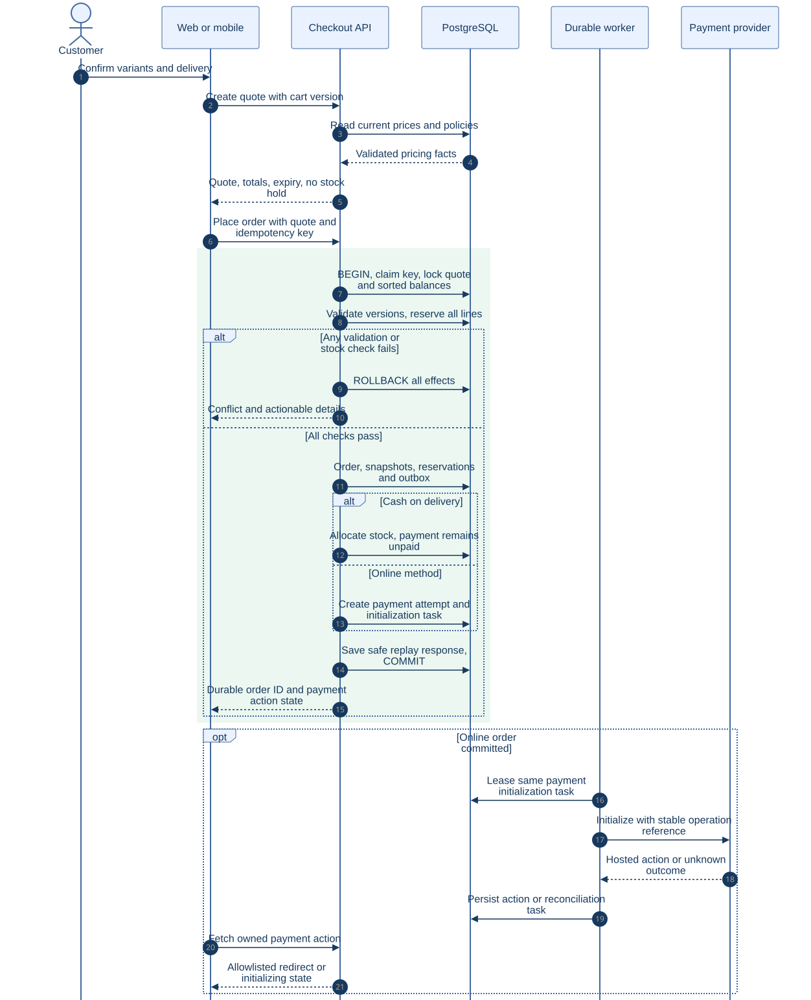
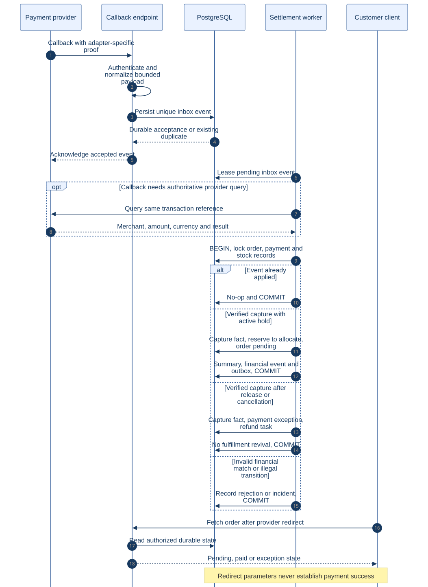
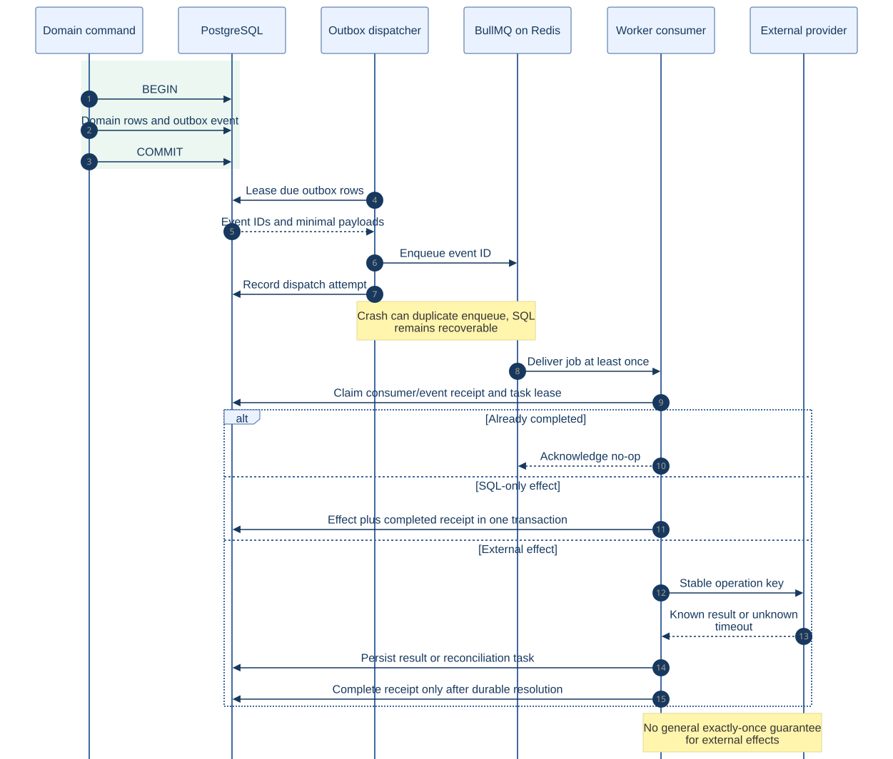

# MyShop Architecture Diagrams

All diagrams describe the proposed backend. SVGs are viewable artifacts; `.mmd` files are editable Mermaid sources. The complete logical model and supporting tables are in [Database design](../DATABASE-DESIGN.md).

For a visible, interactive view, open the [Architecture Atlas](../visual/index.html). It includes the full 64-table schema, 97 foreign keys, table inspectors, index candidates and all ten diagrams below. The [complete schema Mermaid source](../visual/complete-schema.mmd) expands the core ER diagram to every specified table and column.

The SVGs were rendered and checked from all ten Mermaid sources. Open a diagram directly for full-resolution zoom, especially the entity relationship diagram. No online renderer is needed to view the SVG files.

| Diagram | View | Edit | Purpose |
| --- | --- | --- | --- |
| System context | [SVG](01-system-context.svg) | [Mermaid](01-system-context.mmd) | Users, clients and external providers |
| Runtime containers | [SVG](02-containers.svg) | [Mermaid](02-containers.mmd) | API, worker, database, Redis and storage |
| Domain modules | [SVG](03-modules.svg) | [Mermaid](03-modules.mmd) | Domain ownership and orchestration |
| Core entity relationships | [SVG](04-core-erd.svg) | [Mermaid](04-core-erd.mmd) | Identity, catalog, inventory and financial data |
| Checkout sequence | [SVG](05-checkout-sequence.svg) | [Mermaid](05-checkout-sequence.mmd) | Quote, transaction and stock reservation |
| Payment sequence | [SVG](06-payment-sequence.svg) | [Mermaid](06-payment-sequence.mmd) | Callback verification and late capture |
| Order states | [SVG](07-order-state.svg) | [Mermaid](07-order-state.mmd) | Fulfillment transitions |
| Deployment | [SVG](08-deployment.svg) | [Mermaid](08-deployment.mmd) | Infrastructure and release process |
| Returns and refunds | [SVG](09-returns.svg) | [Mermaid](09-returns.mmd) | Inspection and financial tasks |
| Event delivery | [SVG](10-outbox.svg) | [Mermaid](10-outbox.mmd) | Durable dispatch and deduplication |

## System context

## Runtime containers

## Domain modules

## Core entity relationships

## Checkout sequence

## Payment sequence

## Order states

## Deployment

## Returns and refunds

## Event delivery

